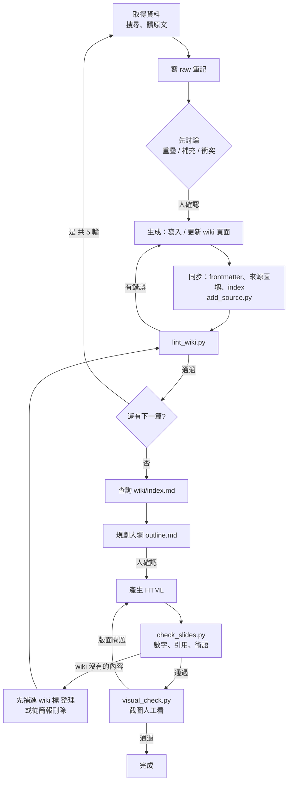

# 用 LLM Wiki 做一份教學 HTML 簡報 —— 主題：AI Agents

> 作業成果說明。打開 `slides/index.html` 即可瀏覽簡報（← → 或空白鍵翻頁）。

## 交付內容一覽

| 作業步驟 | 對應檔案 |
|---|---|
| 步驟一：建立 LLM Wiki | `AGENTS.md`（規則）、`raw/`（5 篇來源筆記）、`discussions/`（5 次「先討論」紀錄）、`wiki/`（22 頁：5 來源頁 + 14 概念頁 + 名詞表 + 目錄 + 紀錄）、`wiki/log.md`（操作紀錄） |
| 步驟二：教學 HTML 簡報 | `slides/outline.md`（大綱）、`slides/index.html`（17 頁簡報） |
| 步驟三：loop / graph 設計 | 本文件第 2 節 |
| 步驟四：反思 | 本文件第 3 節；證據在 `wiki/lint-history/`、`slides/check-history/`、`wiki/log.md` |
| 檢查工具 | `scripts/lint_wiki.py`、`scripts/add_source.py`、`scripts/check_slides.py`、`scripts/visual_check.py` |

### 五篇 ingest 的資料

| 代碼 | 來源 | 類型 |
|---|---|---|
| S1 | Lilian Weng (2023), *LLM Powered Autonomous Agents* | 入門綜述 |
| S2 | Yao et al. (2022 / ICLR 2023), *ReAct* | 學術論文 |
| S3 | Anthropic (2024), *Building effective agents* | 業界實務指南 |
| S4 | OpenAI (2025), *A practical guide to building agents* | 業界實務指南 |
| S5 | Anthropic (2025), *How we built our multi-agent research system* | 工程案例 |

刻意挑選「綜述 → 原始論文 → 兩家公司的指南 → 實際案例」，讓來源之間會出現**需要整合的不同說法**（例如三種 agent 定義、單 agent vs 多 agent），而不是五篇講同一件事。

---

## 1. 資料是如何被取得、整理、檢查，再產生簡報內容的？

一句話：**資料先經過「討論 → 寫入 wiki → 自動檢查」的迴圈累積成知識庫；簡報只能從 wiki 取材，並且要通過「事實對照 + 視覺」兩道檢查。**

```
原文 ──▶ raw/ 閱讀筆記 ──▶ discussions/ 討論紀錄 ──▶ wiki/ 頁面 ──▶ lint 檢查
                                    （人確認後才寫）          │
                                                                 ▼
                    slides/outline.md ◀── 查詢 wiki/index.md ◀── 乾淨的 wiki
                           │
                           ▼
                   slides/index.html ──▶ check_slides（數字 / 引用 / 術語）──▶ 視覺檢查 ──▶ 完成
```

- **取得**：用網路搜尋找到原文，讀全文後在 `raw/` 寫書目資訊與「自己改寫的」筆記（不複製原文段落）。
- **整理**：每篇都先在 `discussions/ingest-NN.md` 列出核心主張、和既有頁面的「重疊 / 補充 / 衝突」、要新增或修改的頁面，決定後才寫入 `wiki/`。不同來源說法不一致時**不覆蓋**，而是寫進 `## 觀點差異` 區塊。
- **檢查**：每個事實性句子都要標來源代碼 `[S1]`～`[S5]`，自己的比喻或整合標 `[整理]`；每輪 ingest 後跑 `lint_wiki.py`。
- **產生簡報**：先查 `wiki/index.md` 排出大綱，每頁標註依據的 wiki 頁面（`data-wiki` 屬性），再產生 HTML；`check_slides.py` 確認簡報裡的每個數字都能在被引用的 wiki 頁面裡找到。

---

## 2. Loop / Graph 設計（步驟三）

### 最終版流程圖



### 哪些步驟會重複執行？

| 迴圈 | 重複什麼 | 實際次數 |
|---|---|---|
| **Ingest 迴圈** | 取得 → 筆記 → 討論 → 生成 → 同步 → lint，每篇資料一輪 | 5 輪 |
| **Lint 修正迴圈** | lint 不過 → 回到生成修正 → 再 lint | 第 1、2 輪各修 1 次；第 3～5 輪一次通過 |
| **簡報檢查迴圈** | 產生 HTML → check_slides → 修正 → 再檢查 | 2 次（第 1 次 2 個問題） |
| **視覺迴圈** | 截圖 → 修版面 → 再截圖 | 2 次 |

### 哪些地方需要檢查或重新生成？

1. **討論節點（人工把關）**：決定哪些內容要收、衝突怎麼處理。這是最便宜的檢查點——還沒寫任何東西。
2. **同步節點**：每改一頁就同步 frontmatter / 來源連結 / index（原本靠 lint 事後抓，後來移到這裡，見反思）。
3. **Lint 節點（自動）**：失效連結、孤立頁面、缺 frontmatter、未登錄來源、index 漏列、沒標來源的段落。
4. **事實對照節點（自動）**：簡報數字必須出現在引用的 wiki 頁面；每頁必須有 `data-wiki`；術語第一次出現必須有中文解釋。
5. **視覺節點（自動 + 人工）**：溢出與 JS 錯誤自動抓，裁切 / 重疊要看截圖。
6. **退回 wiki 而不是只改簡報**：簡報出現 wiki 沒有的內容時，路徑是「先補進 wiki（或刪掉）→ 重新 lint」，不允許只在簡報端修補，以免簡報和 wiki 脫節。

### 為什麼這樣設計？

- **錯誤越早抓越便宜**：wiki 是簡報的唯一來源，wiki 錯了會一路傳到簡報。所以 lint 放在每一輪 ingest 結束時，而不是全部做完才檢查。
- **先討論、後生成**：LLM 最容易出錯的地方是「整合不同來源」。在寫入前先列出衝突，等於把最難的判斷交給人，LLM 負責機械性的整理。
- **自動檢查只做「可以客觀判斷」的事**：連結是否存在、數字是否有出處、術語有沒有解釋。「意思有沒有被扭曲」這種判斷交給討論節點與人工閱讀。
- **把重複出錯的規則寫回 AGENTS.md**：規則檔是 LLM 每次都會讀的「記憶」，所以每次發現新的錯誤模式就把它變成規則或工具，下一輪就不會再犯。

---

## 3. 反思（步驟四）

以下都是這次實際執行時發生的事，紀錄在 `wiki/log.md`、`wiki/lint-history/`、`slides/check-history/`。

### 哪一個節點最常出錯？

**「生成：寫入 / 更新 wiki 頁面」最常出錯；「產生 HTML」出錯次數較少，但錯得最嚴重。**

| 節點 | 發生的錯誤 | 誰抓到的 |
|---|---|---|
| 生成 wiki（第 1 輪） | 定義頁的清單沒標來源；來源頁沒有任何頁面連到它（孤立） | lint |
| 生成 wiki（第 2 輪） | 在兩個頁面加入 S2 的內容，卻忘了更新 frontmatter 的 `sources`；index 沒更新 | lint |
| 生成 wiki（第 5 輪） | 把自己做的比較（「S3 的 orchestrator-workers ≈ S4 的 manager」）標成 `[S3]`，像是來源說的 | 人工重讀（lint 抓不到） |
| 產生 HTML | **簡報自己編了一個 wiki 裡沒有的數字**：ReAct 範例裡的「降雨機率 70%」；封面用了「LLM」卻沒解釋 | check_slides |
| 產生 HTML | 封面 SVG 標籤被裁切、ReAct 頁標籤和內文重疊 | 截圖 |
| lint 工具本身 | 第 1 次跑時把「只有連結的清單」誤判為沒標來源的段落 | 人工看 lint 結果 |

「生成 wiki」錯得多，是因為每次 ingest 都要同時改好幾頁，「改內容」之外還要記得改 metadata，很容易漏。「產生 HTML」雖然只錯一次，但那是**編造事實**——一個看起來很無害的範例數字，正是作業要防的「AI 自己腦補」。

### 發現問題後，把檢查往前移到哪一個步驟？

1. **metadata 同步：從「lint（事後）」往前移到「生成（當下）」**
   第 2 輪 lint 抓到漏改 frontmatter 後，在 `AGENTS.md` §4 的生成步驟加了同步檢查清單；第 4 輪再把它做成 `scripts/add_source.py`，改完內容立刻執行。結果第 3、4、5 輪 lint 都一次通過。
2. **教學範例：從「簡報檢查」往前移到「wiki 生成」**
   「70%」事件後規定：簡報要用的範例必須先寫進 wiki（標 `[整理]`、不放假數字），簡報才能引用（`AGENTS.md` §7 第 6 條）。範例因此和其他內容一樣會經過 wiki 的檢查。
3. **來源連結：從「lint 抓孤立頁面」往前移到「頁面格式規則」**
   第 1 輪後規定每個概念頁都要有 `## 來源` 區塊，孤立頁面的問題從此不再發生。

### 有沒有因此修改 workflow / graph？為什麼？

有，最終流程圖比一開始多了三個東西：

| 修改 | 原本 | 修改後 | 原因 |
|---|---|---|---|
| 新增「同步」節點 | 生成 → lint | 生成 → **同步（add_source.py）** → lint | 同一種錯連續出現，靠記得做不可靠，改用工具保證 |
| 新增「退回 wiki」的邊 | 簡報有問題就直接改簡報 | 簡報出現 wiki 沒有的內容 → **回到 wiki 補充或刪除 → 重新 lint** | 如果只改簡報，wiki 就不再是唯一來源，之後重新生成又會出同樣的錯 |
| 新增「視覺檢查」節點 | 文字檢查通過就結束 | check_slides → **visual_check（截圖）** | 文字檢查完全看不到裁切和重疊，但學生看簡報時第一眼就會看到 |

### 這次做法的限制（誠實說明）

- **檢查者和生成者是同一個模型**：自動檢查能抓到格式與數字問題，但「意思有沒有被扭曲」仍可能漏掉（例如第 5 輪的錯誤標註是重讀才發現）。更嚴謹的做法是讓另一個人或另一個獨立的 agent 做事實檢查。
- **數字檢查只比對「有沒有出現」**：check_slides 能確認 90.2% 出現在 wiki，但不能確認簡報對它的描述是否正確，這部分仍靠人。

---

## 如何重新執行檢查

```bash
python3 scripts/lint_wiki.py --report wiki/lint-report.md   # 檢查 wiki
python3 scripts/check_slides.py                             # 簡報對照 wiki
python3 scripts/visual_check.py                             # 截圖（需要 playwright）
python3 scripts/add_source.py S6 wiki/concepts/xxx.md       # 新增來源後同步 metadata
```

## 參考資料

- Karpathy, A. (2026). *LLM Wiki*（GitHub Gist）——本作業 wiki 結構的概念來源
- S1～S5 見上表；完整連結在 `wiki/sources/` 與簡報最後一頁
